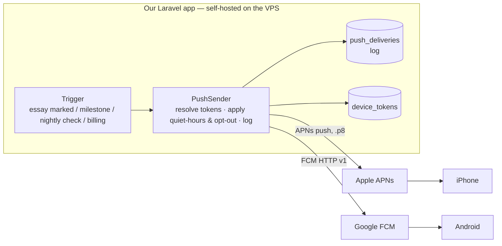

# Push notifications (self-hosted)

Push is how SmoothSeas reaches a **closed app on another phone at a moment the server (or a
human teacher) chooses**. It is the only mechanism that makes the *teacher-in-the-loop*
promise tangible — a parent's phone lighting up the evening a real teacher marks their
child's essay — and the only way to reach the **parent's** device about the **child's**
activity, since they are usually different devices.

Specified by **`push_notifications.feature`** (scenarios `PN-01`–`PN-08`).

!!! note "Status"
    **Planned (roadmap).** This document, the BDD feature, and the test infrastructure are
    built first. The sender, migrations, device-token registration and triggers are
    implemented against these specs afterward. Until then the `PN` Pest tests are present,
    tagged, and skipped with a pointer here.

## Why not just local notifications?

Local notifications (see the Capacitor reminders plan) are alarms the phone sets for itself
from a schedule we hand it a week ahead — perfect for "Captain's Orders are ready at
3:30pm". They **cannot** do any of the four jobs below, because the timing and the content
are unknown when the schedule is set, the data is fresh on the server, and/or the target is
a *different device* from the one doing the work.

## Why self-hosted, and what "self-hosted" means here

The phone's final wake-up hop is owned by Apple (APNs) and Google (FCM) and cannot be
self-hosted — every push-capable app shares those gateways. **Everything else is ours:**

| Piece | Where it lives |
| --- | --- |
| Deciding who gets what, and when (triggers, quiet hours, opt-out) | Our Laravel app |
| Storing device tokens, building the payload | Our Laravel app / our DB |
| Sending to the gateway | Our server — a direct HTTPS call per push |
| Waking the phone | Apple / Google (unavoidable, shared by all apps) |

Concretely:

- **iOS → APNs directly** with our own `.p8` auth key. **No Firebase at all** — a child's
  essay-feedback notification never passes through Google.
- **Android → FCM HTTP v1 API directly** with our own Google service-account JSON. We use
  FCM as a plain authenticated HTTPS endpoint — **not** the Firebase SDK and **not** the
  Firebase console. The only Google touchpoint is the token the Capacitor push plugin needs
  on Android; our logic and data stay on our VPS.

This keeps data residency strong (important for a children's product), the APKs lean (no
Google-services SDK to rebuild), and the whole send path testable as an ordinary Laravel
service. The one thing we forgo — Firebase's delivery dashboard — we replace with our own
delivery log in the admin panel, which we want anyway.

## User stories

| ID | As a… | I want… | So that… |
| --- | --- | --- | --- |
| PN-01 | parent/child on the native app | my device's push token registered on launch | the server can reach my phone later |
| PN-02 | operator | dead tokens pruned on gateway rejection | we never waste sends or leak to reassigned devices |
| PN-03 | parent | opt-out and quiet hours honoured | the app never nags at the wrong time |
| PN-04 | parent | a push the moment a teacher marks my child's essay | the human-in-the-loop promise feels real and immediate |
| PN-05 | parent | a push when my child hits a milestone | I can celebrate it even when I'm not holding their tablet |
| PN-06 | parent/child | a gentle nudge when my child drifts away | we recover the habit before the streak and the money lapse |
| PN-07 | account owner | billing/security pushes regardless of quiet hours | I never miss a renewal or a failed payment |
| PN-08 | operator | every send attempt logged and visible in admin | we can see, critique and debug deliveries |

### Critical vs non-critical

`PN-03` and `PN-07` hinge on one distinction:

- **Non-critical** (streaks, reminders, re-engagement, milestones) — suppressed by opt-out
  and quiet hours, and recorded as *suppressed*.
- **Critical** (billing, security/account) — always delivered, recorded as a *critical*
  delivery. A family cannot mute a failed payment into silence.

## Architecture

### Components (implemented later, specified now)

- **`device_tokens`** — `user_id`, `platform` (`ios`/`android`), `token`, `last_seen_at`.
  A device registers via an authenticated endpoint on app launch; re-registering the same
  token updates it rather than duplicating (`PN-01`).
- **`PushSender`** — the one orchestrator. Given a target user and a `PushMessage`, it
  resolves the user's tokens, applies opt-out + quiet hours by message criticality
  (`PN-03`, `PN-07`), dispatches each token through the transport for its platform, prunes
  tokens the gateway reports dead (`PN-02`), and writes a `push_deliveries` row per attempt
  (`PN-08`).
- **`PushTransport`** (contract) with two real implementations — `ApnsTransport` (direct,
  `.p8` JWT) and `FcmTransport` (direct, HTTP v1) — and an in-memory `FakePushTransport`
  for tests. `PushSender` depends only on the contract, so tests never hit a gateway
  (`PN-08`).
- **`push_deliveries`** — one row per attempt: user, platform, message type, criticality,
  outcome (`delivered` / `suppressed` / `failed`), and gateway response. This is the admin
  panel's source of truth.
- **Triggers** — essay-feedback published (`PN-04`), milestone recorded (`PN-05`), a nightly
  re-engagement command (`PN-06`), billing/security events (`PN-07`). Each builds a
  `PushMessage` and hands it to `PushSender`; none talks to a gateway itself.

## Test infrastructure

Push is tested **entirely offline**. The seam is the `PushTransport` contract:

- **`FakePushTransport`** (`tests/Support/`) records every `PushMessage` it is asked to
  send and can be told to report specific tokens as *unregistered* (to prove pruning,
  `PN-02`) or *rate-limited* (to prove retention). It is bound in place of the real
  transports in tests, so **no test ever contacts Apple or Google**.
- **Value objects** — `PushMessage` (type, criticality, title/body, data/deep-link, target
  user) and `PushResult` (sent tokens, rejected tokens, retryable tokens) are plain,
  assertable PHP. They exist now as the contract the specs bind to.
- **`tests/Feature/PushNotificationsTest.php`** — one Pest test per scenario, tagged
  `@group scenario:PN-0x`, so `php artisan specs:trace` maps each `PN` scenario to its test.
  Until the sender and schema are implemented the tests are **skipped** with a reason
  pointing here; they encode the expected behaviour so implementation is red-to-green.

## Build order

1. **Specs first (this pass):** feature file, this doc, `PushTransport` contract + value
   objects + `FakePushTransport`, and the tagged (skipped) Pest tests.
2. **Schema + registration:** `device_tokens`, `push_deliveries`, the registration endpoint,
   and the Capacitor push-plugin bridge in the native shell. Un-skip `PN-01`/`PN-02`.
3. **Sender:** `PushSender` with quiet-hours/opt-out and delivery logging; `ApnsTransport`
   and `FcmTransport`. Un-skip `PN-03`/`PN-08`.
4. **Triggers:** essay-feedback, milestone, nightly re-engagement, billing. Un-skip
   `PN-04`–`PN-07`.
5. **Admin:** a Filament resource over `push_deliveries` to view and critique sends.

No scenario is marked verified in the ledger until it is checked in a real browser/app
(gate G5).
